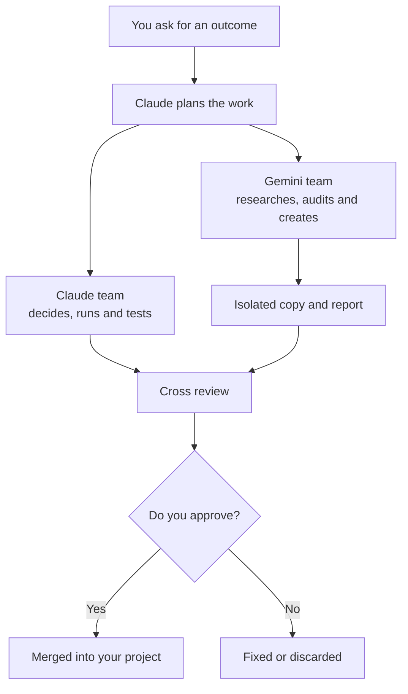

<div align="center">



<a href="LICENSE"></a>


[Español](README.md) · **English**

[Quick start](#quick-start) · [How it works](#how-it-works) · [Prompts](docs/prompts.en.md) · [Security](SECURITY.md)

</div>

| 🤖 Agents | 🧠 Skills | 🗂️ Work areas | ⚡ Actions | 🌎 Languages |
| :--: | :--: | :--: | :--: | :--: |
| **15** | **101** | **6** | **34** | **ES + EN** |

---

## Technical overview

Cuadrilla is a Claude Code plugin for multi-agent orchestration on Windows. It registers an MCP delegation tool, a status panel and routing hooks. It launches Antigravity CLI agents without a shell, isolates writes with `git worktree`, selects models per turn and treats output from other models as untrusted data.

## How it works



Gemini edits stay in an isolated branch and folder until you review and approve them.

## Quick start

You need Windows 10 or 11, a Claude account with Claude Code, and a Google account.

```powershell
winget install --id Git.Git -e
irm https://claude.ai/install.ps1 | iex
irm https://antigravity.google/cli/install.ps1 | iex
```

Open a new PowerShell window and sign in once to each tool:

```powershell
claude
agy
```

Use `/exit` to leave each one. When Antigravity asks about data use, you can opt out of sharing your interactions.

Install Cuadrilla:

```powershell
git clone https://github.com/PanchoJr34/Cuadrilla-IA-S.git "$HOME\Cuadrilla-IA-S"; cmd /c "$HOME\Cuadrilla-IA-S\instalar.cmd"
```

Keep that folder. Restart Claude Code, open a project and type `/cuadrilla`.

## The panel

Track usage, model choice, agents and jobs from Claude Code.

<p align="center"></p>

## What you get

- **8 Gemini agents:** researcher, web auditor, SEO and marketing, copywriter, frontend, UI designer, reviewer and documentation writer.
- **7 Claude agents:** architect, frontend, UI designer, SEO and marketing, copywriter, QA and security reviewer.
- **101 skills:** web development, design, marketing, content, sales and security.
- **Live panel:** Claude and Gemini usage, active agents, jobs and work areas.
- **Automatic model choice:** Haiku, Sonnet or Opus per turn, and Flash or Argon for Gemini. It uses simple rules, in English or Spanish.

Say "use opus" to choose a model. Use `/cuadrilla-auto off` to turn automatic selection off.

## Where it works

| Surface | Support |
| --- | --- |
| Claude Code in a terminal | Yes |
| VS Code extension | Yes, local sessions |
| Desktop app | Local Claude Code sessions |
| Cloud sessions | No |
| Regular Claude chat | No plugin; a skill can provide the method |

## Update

Review the changes first, then run:

```powershell
git -C "$HOME\Cuadrilla-IA-S" pull; cmd /c "$HOME\Cuadrilla-IA-S\instalar.cmd"
```

## Uninstall

```powershell
claude plugin uninstall cuadrilla@cuadrilla
claude plugin marketplace remove cuadrilla
agy plugin uninstall cuadrilla
Remove-Item "$HOME\Cuadrilla-IA-S" -Recurse -Force
```

## Limits

- Gemini agents have no terminal: they do not run tests, builds or installs.
- Up to 3 Gemini jobs run at once.
- Read-only mode detects changes in Git repositories, but cannot guarantee it prevents them.

## Security and privacy

Cuadrilla has no server or telemetry. Tasks and files read by Gemini go to Google, and Claude work goes to Anthropic, under your accounts. Do not delegate secrets. See [SECURITY.md](SECURITY.md) and [PRIVACIDAD.md](PRIVACIDAD.md).

## License

Original code is under the [MIT License](LICENSE). Third-party skills keep their authors and licenses in [`third_party/`](third_party/SOURCES.md).
