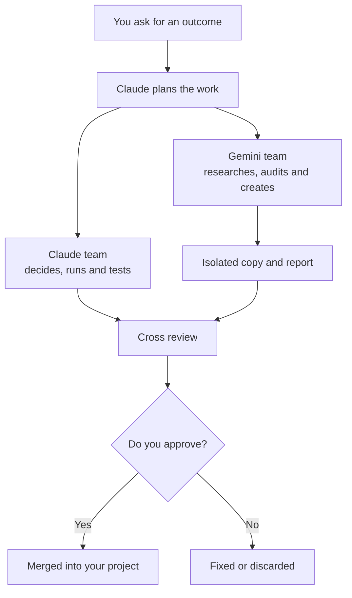

<div align="center">



<a href="LICENSE"></a>


[Español](README.md) · **English**

[Quick start](#quick-start) · [How it works](#how-it-works) · [Prompts](docs/prompts.en.md) · [Security](SECURITY.md)

</div>

| AGENTS | SKILLS | WORK AREAS | ACTIONS | LANGUAGES |
| :--: | :--: | :--: | :--: | :--: |
| **15** | **101** | **6** | **34** | **ES / EN** |

---

## Technical overview

Cuadrilla is a Claude Code plugin for multi-agent orchestration on Windows and macOS. It registers an MCP delegation tool, a status panel and routing hooks. It launches Antigravity CLI agents without a shell, isolates writes with `git worktree`, selects models per turn and treats output from other models as untrusted data.

## What it is

Cuadrilla turns Claude Code into an AI team for web work. Instead of asking one assistant to do everything, you describe the outcome and the work gets split: Claude plans, Gemini researches or creates, another agent reviews, and you approve.

| Without Cuadrilla | With Cuadrilla |
| :-- | :-- |
| One chat does everything | A specialist takes each part |
| The same model for every task | The model changes with the work |
| Heavy reading burns your limits | Gemini can take that part |
| Authors review their own work | Claude and Gemini review each other |
| Changes land directly in the project | Gemini edits in an isolated copy |

<p align="center"></p>

### When it fits

- You work on Windows or macOS with Claude Code.
- You build sites, landing pages, digital products, SEO or campaigns.
- You want to get more out of your Claude and Google plans.
- You prefer to approve every important change.

### When it does not

- You only need a chat for quick questions.
- You work on Linux: Cuadrilla ships installers for Windows and macOS.
- You cannot send your code or data to Anthropic or Google.

## How it works



Gemini edits stay in an isolated branch and folder until you review and approve them.

## Quick start

You need Windows 10 or 11, a Claude account with Claude Code, and a Google account.

```powershell
winget install --id Git.Git -e
irm https://claude.ai/install.ps1 | iex
irm https://antigravity.google/cli/install.ps1 | iex
```

Open a new PowerShell window and sign in once to each tool:

```powershell
claude
agy
```

Use `/exit` to leave each one. When Antigravity asks about data use, you can opt out of sharing your interactions.

Install Cuadrilla:

```powershell
git clone https://github.com/PanchoJr34/Cuadrilla-IA-S.git "$HOME\Cuadrilla-IA-S"; cmd /c "$HOME\Cuadrilla-IA-S\instalar.cmd"
```

Keep that folder. Restart Claude Code, open a project and type `/cuadrilla`.

### macOS

Requirements: macOS 13 Ventura or later, Apple Silicon or Intel, 4 GB of RAM or more, Git (from the Xcode command line tools), Claude Code and Antigravity CLI. No Homebrew, Python or Node.js needed.

```bash
xcode-select --install
curl -fsSL https://claude.ai/install.sh | bash
curl -fsSL https://antigravity.google/cli/install.sh | bash
```

Open a new Terminal window and sign in once with `claude` and `agy`. If either command is not found, add `~/.local/bin` to your `PATH`. Then install Cuadrilla:

```bash
git clone https://github.com/PanchoJr34/Cuadrilla-IA-S.git ~/Cuadrilla-IA-S && bash ~/Cuadrilla-IA-S/instalar.sh
```

If something fails, run `bash ~/Cuadrilla-IA-S/verificar.sh`. To update, run `git -C ~/Cuadrilla-IA-S pull && bash ~/Cuadrilla-IA-S/instalar.sh`.

## The panel

Track usage, model choice, agents and jobs from Claude Code.

<p align="center"></p>

## What you get

- **8 Gemini agents:** researcher, web auditor, SEO and marketing, copywriter, frontend, UI designer, reviewer and documentation writer.
- **7 Claude agents:** architect, frontend, UI designer, SEO and marketing, copywriter, QA and security reviewer.
- **101 skills:** web development, design, marketing, content, sales and security.
- **Live panel:** Claude and Gemini usage, active agents, jobs and work areas.
- **Automatic model choice:** Haiku, Sonnet or Opus per turn, and Flash or Argon for Gemini. It uses simple rules, in English or Spanish.

Say "use opus" to choose a model. Use `/cuadrilla-auto off` to turn automatic selection off.

## Where it works

| Surface | Support |
| --- | --- |
| Claude Code in a terminal | Yes |
| VS Code extension | Yes, local sessions |
| Desktop app | Local Claude Code sessions |
| Cloud sessions | No |
| Regular Claude chat | No plugin; a skill can provide the method |

## Update

Review the changes first, then run:

```powershell
git -C "$HOME\Cuadrilla-IA-S" pull; cmd /c "$HOME\Cuadrilla-IA-S\instalar.cmd"
```

If Claude Code is already open, type `/reload-plugins` or, in VS Code, run `Developer: Reload Window`.

## Uninstall

```powershell
claude plugin uninstall cuadrilla@cuadrilla
claude plugin marketplace remove cuadrilla
agy plugin uninstall cuadrilla
Remove-Item "$HOME\Cuadrilla-IA-S" -Recurse -Force
```

## Limits

- Gemini agents have no terminal: they do not run tests, builds or installs.
- Up to 3 Gemini jobs run at once.
- In read-only mode Antigravity denies edits. If you or Claude change files meanwhile, the job ends with a warning, not a failure.
- Long reports are delivered in parts; Claude asks for the rest.
- Gemini quota only refreshes when you use `agy` interactively. The panel flags it when it is older than an hour: open `agy`, send a short message and close it.

## Security and privacy

### What it stores

Cuadrilla **does not ask for or store passwords or tokens**. It has no server or telemetry. It uses the sessions you started in Claude Code and Antigravity.

| Location | What stays there |
| --- | --- |
| Claude Code, Antigravity and Git | Their own sessions, same as without Cuadrilla |
| `.gemini\cuadrilla-estado.json` | `agy` state, including your email and quota |
| `.cuadrilla\` in each project | Reports and isolated copies |

Gemini can read a file with secrets if a task or another file leads it there. The filter for `.env`, keys and credentials only removes them from the initial list; it does not block reading. Anything Gemini reads goes to Google, and anything Claude uses goes to Anthropic.

**Protect your projects:**

- Do not keep passwords or keys in code.
- Use environment variables or a secrets manager.
- Do not delegate tasks involving `.env`, backups or personal data.
- If a secret reaches a report, rotate it and delete that report.

See [SECURITY.md](SECURITY.md) and [PRIVACIDAD.md](PRIVACIDAD.md).

## License

Original code is under the [MIT License](LICENSE). Third-party skills keep their authors and licenses in [`third_party/`](third_party/SOURCES.md).
