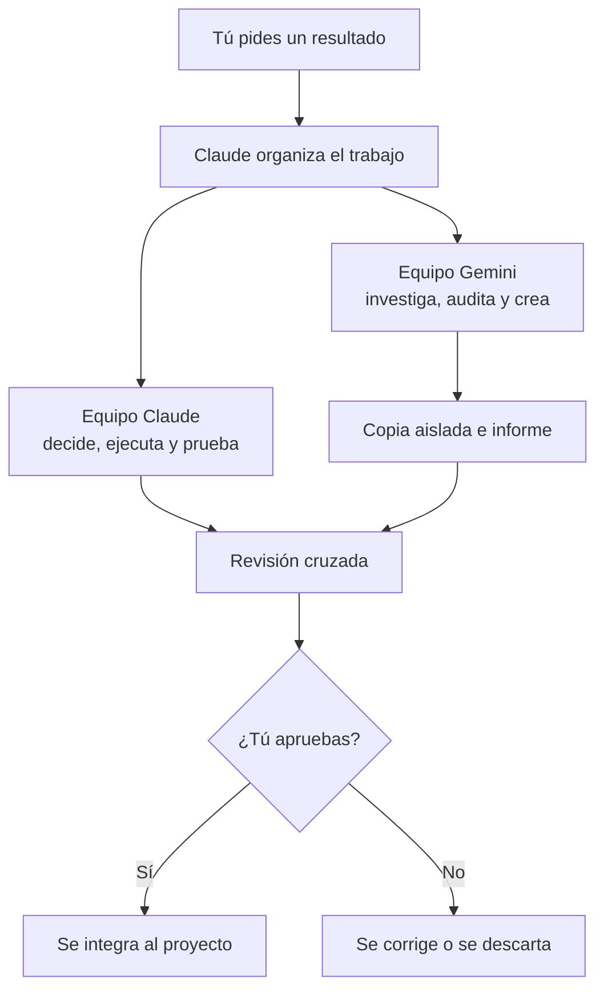

<div align="center">

# Cuadrilla IA

**Tu equipo de agentes de Claude y Gemini para crear, mejorar y lanzar productos web.**

Plugin para Claude Code en Windows · 15 agentes · 47 skills · Sin WSL

[Empezar](#empezar-en-10-minutos) · [Cómo funciona](#cómo-funciona) · [Prompts](docs/prompts.md) · [Privacidad](PRIVACIDAD.md)

</div>

---

## Qué es

Cuadrilla convierte a Claude Code en un equipo de trabajo. Le pides un resultado, y Claude organiza quién hace cada parte: unas tareas las resuelven agentes de Claude y otras los agentes de Gemini, con tu plan de Google.

Sirve para cuando el trabajo ya no cabe en una sola conversación: auditar un sitio, crear una landing, preparar un lanzamiento o entender un proyecto ajeno. Tú sigues decidiendo. Lo que Gemini cambia queda en una copia aparte hasta que lo revises y lo apruebes.

## Cómo funciona



Un ejemplo real:

1. Pides: "Audita esta web y dime qué arreglar primero".
2. `gemini-auditor-web` revisa el proyecto y `gemini-seo-marketing` revisa SEO y mensaje.
3. `revisor-seguridad` de Claude revisa los puntos delicados.
4. Claude cruza los informes, comprueba lo importante y te entrega un plan con prioridades.

## Empezar en 10 minutos

### 1. Revisa lo que necesitas

| Necesitas | Para qué |
| --- | --- |
| Windows 10 u 11 | Sistema compatible |
| Cuenta de Claude con Claude Code (Pro, Max, Team o Enterprise) | Claude y sus agentes |
| Cuenta de Google | Gemini; el uso depende de tu plan |
| Cuenta de GitHub con acceso al repo | Descargar Cuadrilla mientras sea privado |

### 2. Instala las herramientas

Abre **PowerShell** y corre estos comandos, uno por uno:

```powershell
winget install --id Git.Git -e
irm https://claude.ai/install.ps1 | iex
irm https://antigravity.google/cli/install.ps1 | iex
```

Cierra PowerShell y abre una ventana nueva. Si `claude` o `agy` no se reconocen, cierra sesión en Windows y vuelve a entrar.

### 3. Inicia sesión con tus cuentas

Cada persona usa sus propias cuentas. Cuadrilla nunca te pide contraseñas.

**Claude**

```powershell
claude
```

Sigue el navegador, entra con tu cuenta de Claude y autoriza. Cuando vuelvas a la terminal, escribe `/exit`.

**Gemini**

```powershell
agy
```

Elige colores con Enter y entra con tu cuenta de Google. En la pantalla de datos puedes desmarcar **"Yes, I agree to help improve Antigravity CLI"**: presiona Enter sobre la opción, baja a `[Done]` y confirma. Luego sal con `/exit`.

Comprueba Gemini:

```powershell
agy -p "Responde solo: OK" --output-format json
```

Debe decir `"status":"SUCCESS"`.

**GitHub**

```powershell
git ls-remote https://github.com/PanchoJr34/Cuadrilla-IA-S.git
```

Si abre una ventana, elige **Sign in with your browser** y autoriza. Debe mostrar una línea con `HEAD`.

### 4. Instala Cuadrilla

```powershell
git clone https://github.com/PanchoJr34/Cuadrilla-IA-S.git "$HOME\Cuadrilla-IA-S"; cmd /c "$HOME\Cuadrilla-IA-S\instalar.cmd"
```

El instalador agrega Cuadrilla y el equipo Gemini, y te pregunta si quieres sumar los plugins oficiales. No borres esa carpeta.

### 5. Pruébala

Abre un proyecto:

```powershell
cd "C:\ruta\de\tu\proyecto"
claude
```

Escribe `/cuadrilla` y pega:

```text
Audita este proyecto en solo lectura. gemini-auditor-web revisa la estructura, gemini-seo-marketing revisa el mensaje y revisor-seguridad revisa los riesgos. Cruza los informes y dame un plan priorizado.
```

Si algo falla, corre `cmd /c "$HOME\Cuadrilla-IA-S\verificar.cmd"`.

## Dónde funciona

| Lugar | Cuadrilla |
| --- | --- |
| Claude Code en terminal | Sí |
| Extensión de VS Code | Sí, en sesiones locales |
| App de escritorio | Sí, en sesiones locales de Claude Code |
| Sesiones en la nube | No |
| Chat normal de Claude | No corre el plugin; usa una skill como guía |

## El equipo

### Equipo Gemini

Trabaja en segundo plano, sin terminal. No ve tu chat, así que Claude le da una tarea completa.

| Agente | Se encarga de | Modo habitual |
| --- | --- | --- |
| `gemini-investigador` | Investigación y documentación | Lectura |
| `gemini-auditor-web` | Auditorías de proyecto | Lectura |
| `gemini-seo-marketing` | SEO, mensaje y conversión | Lectura |
| `gemini-revisor` | Revisar cambios | Lectura |
| `gemini-frontend` | Páginas y componentes | Copia aislada |
| `gemini-disenador-ui` | Dirección y pulido visual | Copia aislada |
| `gemini-copywriter` | Textos | Copia aislada |
| `gemini-documentador` | Documentación | Copia aislada |

### Equipo Claude

Decide, usa herramientas, ejecuta y prueba.

| Agente | Se encarga de | Permisos |
| --- | --- | --- |
| `arquitecto-web` | Arquitectura y plan técnico | Lectura |
| `frontend` | Implementación | Edita y ejecuta |
| `disenador-ui` | Dirección visual | Edita |
| `seo-marketing` | Estrategia y SEO | Lectura |
| `copywriter` | Textos | Edita |
| `qa-web` | Pruebas | Ejecuta, no edita |
| `revisor-seguridad` | Seguridad y calidad | Lectura |

## Usar lo que hizo Gemini

Cuando Gemini edita, trabaja en una copia aparte y no toca tu proyecto. Al terminar:

1. Pide a Claude: `Muéstrame los archivos que cambió y el diff`.
2. Si te convence: `Integra estos cambios en mi proyecto y pruébalos`.
3. Si no: `Descarta esa copia aislada`.

La escritura solo funciona con `gemini-frontend`, `gemini-disenador-ui`, `gemini-copywriter` y `gemini-documentador`.

## Prompts recomendados

Usa esta estructura para que el equipo entienda mejor:

```text
OBJETIVO: Qué quieres lograr.
CONTEXTO: Negocio, audiencia y situación actual.
ALCANCE: Qué se puede tocar y qué no.
EQUIPO: Quién debe hacer cada parte.
ENTREGA: Formato del resultado.
LÍMITES: Datos que no se deben inventar y aprobaciones necesarias.
```

Encuentra prompts completos para auditorías, landings, SEO, marketing, rediseños y documentación en [`docs/prompts.md`](docs/prompts.md).

## Qué incluye

### Plugins oficiales

El instalador agrega plugins públicos de Anthropic:

| Área | Plugins |
| --- | --- |
| Código | `code-review`, `pr-review-toolkit`, `feature-dev`, `code-simplifier`, `engineering` |
| Diseño | `frontend-design`, `design` |
| Seguridad | `security-guidance` |
| Negocio | `marketing`, `product-management`, `data`, `productivity` |
| Claude Code | `claude-code-setup`, `claude-md-management`, `skill-creator` |

Pueden sumar gasto de contexto y algunos usan hooks o conectores. Desactiva los que no necesites con `/plugin`. Los conectores externos requieren tu autorización.

### Skills

Disponibles para Claude y Gemini. Las de terceros son copias fijas en Markdown, sin scripts. `pick-ui-library`, `prototype` y `review-animations` solo corren si las pides por nombre.

<details>
<summary><strong>Flujos de Cuadrilla</strong></summary>

| Skill | Para qué sirve |
| --- | --- |
| `equipo-web` | Reparte un proyecto entre Gemini y los agentes |
| `auditoria-sitio` | Audita un sitio y entrega un plan priorizado |
| `landing-completa` | Crea una landing de principio a fin |
| `auditar-setup` | Revisa tu configuración sin cambiarla |
| `entender-codigo` | Explica un proyecto antes de tocarlo |
| `auditoria-base-datos` | Busca causas comunes de lentitud |
| `contexto-proyecto` | Documenta el contexto para futuros agentes |

</details>

<details>
<summary><strong>Desarrollo web</strong></summary>

| Skill | Para qué sirve |
| --- | --- |
| `frontend-ui-engineering` | Construir interfaces accesibles y responsivas |
| `api-and-interface-design` | Diseñar APIs e interfaces estables |
| `performance-optimization` | Medir y mejorar rendimiento |
| `security-and-hardening` | Reforzar la seguridad |
| `code-review-and-quality` | Revisar código antes de integrarlo |
| `browser-testing-with-devtools` | Probar en navegador con DevTools MCP |
| `shipping-and-launch` | Preparar una salida a producción |
| `planning-and-task-breakdown` | Dividir el trabajo en tareas |
| `debugging-and-error-recovery` | Encontrar la causa de un error |

</details>

<details>
<summary><strong>Diseño y animación</strong></summary>

| Skill | Para qué sirve |
| --- | --- |
| `frontend-design` | Evitar diseños genéricos |
| `emil-design-eng` | Aplicar criterio de ingeniería de diseño |
| `make-interfaces-feel-better` | Pulir detalles de interfaz |
| `pick-ui-library` | Elegir librerías de frontend |
| `prototype` | Crear y comparar versiones de una interfaz |
| `break-ui` | Probar la interfaz con datos extremos |
| `animate` | Crear animaciones con criterio |
| `animation-vocabulary` | Encontrar el nombre exacto de un efecto |
| `animation-performance` | Mantener animaciones fluidas |
| `review-animations` | Revisar animaciones existentes |
| `improve-animations` | Auditar y planear mejoras |
| `find-animation-opportunities` | Encontrar dónde sí conviene animar |

</details>

<details>
<summary><strong>Marketing</strong></summary>

| Skill | Para qué sirve |
| --- | --- |
| `product-marketing` | Definir contexto de producto y mensaje |
| `marketing-plan` | Crear un plan de marketing |
| `marketing-psychology` | Aplicar principios de comportamiento |
| `customer-research` | Analizar investigación de clientes |
| `content-strategy` | Decidir qué contenido crear |
| `copywriting` | Escribir textos para páginas |
| `copy-editing` | Editar textos existentes |
| `humanizer` | Quitar el tono artificial de un texto |
| `emails` | Crear secuencias de correo |
| `social` | Crear contenido para redes |
| `launch` | Planear un lanzamiento |
| `pricing` | Definir precios y paquetes |

</details>

<details>
<summary><strong>SEO, conversión y analítica</strong></summary>

| Skill | Para qué sirve |
| --- | --- |
| `seo-audit` | Auditar SEO |
| `ai-seo` | Mejorar presencia en buscadores con IA |
| `schema` | Crear datos estructurados |
| `site-architecture` | Planear páginas, navegación y URLs |
| `cro` | Mejorar conversión de páginas |
| `signup` | Mejorar registro y activación |
| `analytics` | Definir y revisar medición |

</details>

## Mapa del proyecto

```text
Cuadrilla-IA-S/
├── agents/            Agentes de Claude
├── gemini/
│   ├── agents/        Agentes de Gemini
│   └── plugin.json    Manifiesto para Antigravity
├── skills/            Skills compartidas
├── references/        Listas de revisión de las skills
├── hooks/             Delegación, panel y pruebas
├── docs/
│   ├── prompts.md     Prompts listos para usar
│   └── recursos.md    Catálogo de recursos
├── third_party/       Licencias y origen de terceros
├── instalar.cmd       Instalación y actualización
├── verificar.cmd      Diagnóstico
└── PRIVACIDAD.md      Privacidad y condiciones de uso
```

## Mantenimiento

### Actualizar

Cierra Claude Code, revisa qué cambió y corre:

```powershell
git -C "$HOME\Cuadrilla-IA-S" pull; cmd /c "$HOME\Cuadrilla-IA-S\instalar.cmd"
```

### Desinstalar

Cierra Claude Code y corre:

```powershell
claude plugin uninstall cuadrilla@cuadrilla
claude plugin marketplace remove cuadrilla
agy plugin uninstall cuadrilla
Remove-Item "$HOME\Cuadrilla-IA-S" -Recurse -Force
```

Los plugins oficiales se quitan aparte con `claude plugin uninstall <plugin>@<marketplace>`. Cada proyecto puede conservar `.cuadrilla` con informes y copias: revisa que no haya nada pendiente antes de borrarla.

## Límites

- Gemini no ejecuta comandos, pruebas ni compilaciones.
- Corren hasta 3 trabajos de Gemini a la vez.
- Recibe hasta 300 nombres de archivo y cada tarea admite hasta 20,000 caracteres.
- Un trabajo se detiene tras 10 minutos sin actividad o 45 minutos en total.
- La solo lectura se comprueba en repositorios Git: detecta cambios, pero no garantiza impedirlos.

## Estado

| Función | Estado |
| --- | --- |
| Delegación, solo lectura y copia aislada | Probado en Windows |
| Equipo mixto con Gemini y Claude | Probado en Windows |
| Panel y agentes `gemini-*` en terminal | Probado en Windows |
| Plugins oficiales | Instalación probada en Linux |
| VS Code y app de escritorio | Falta probar en Windows |

## Problemas comunes

| Mensaje | Solución |
| --- | --- |
| No se reconoce `claude` o `agy` | Abre una terminal nueva o reinicia sesión en Windows |
| Falla el clon del repo | Corre `git ls-remote` y autoriza GitHub |
| `write: true` necesita Git | Trabaja en un repositorio con al menos un commit |
| No aparecen los agentes de Gemini | Corre `verificar.cmd` y luego `agy agents` |
| Gemini termina sin informe | Quita pasos que requieran comandos y lánzalo otra vez |
| El panel no aparece | Escribe `/cuadrilla` |

## Desarrollo

```powershell
claude plugin validate .
claude plugin test .
claude --plugin-dir .
agy plugin validate --strict .\gemini
```

## Créditos y licencia

Código propio bajo licencia [MIT](LICENSE). Las skills de terceros conservan su autoría y licencia en [`third_party/`](third_party/SOURCES.md). Parte del formato de salida de `agy` y el panel se basan en [orchestra](https://github.com/TheAlejo160/orchestra), también MIT.
